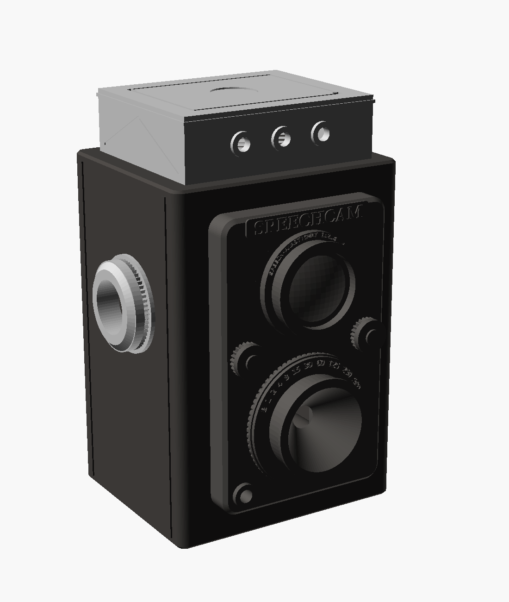

# SpeechCam: Club Speech Recorder

A speech recorder built into a 3D-printed 1950s twin-lens reflex camera.
Press the focus knob and it records the speaker in 1080p with clear sound
from a wireless lav mic. Green / yellow / red timing lights on the finder
hood show the speaker their time. Afterwards you download an MP4 to your
phone over Wi-Fi.



## How it works

```
 Raspberry Pi Camera Module 3 (behind the lower "taking" lens) ──ribbon──┐
 Wireless lav mic receiver ──USB-C → micro-USB OTG cable─────────────────┼── Pi Zero W
 Buttons, timing lights, REC tally, beeper (PAM8302 + speaker) ──GPIO────┘
```

- **Picture:** Camera Module 3 (12 MP, autofocus). The Pi Zero's hardware
  encoder records 1080p30 H.264 at 6 Mbit/s live, using almost no CPU.
- **Sound:** your wireless lav, recorded uncompressed while you film.
- **After each speech:** the Pi packs the video and sound into an `.mp4`,
  which takes about a minute. That's ~45 MB per minute of video, so a 7-minute speech is ~300 MB.
- **Web page** at `http://speechcam.local:8080`: record/stop, speaker name,
  timing profile, a live timer, and downloads. Each recording gets a `.json`
  file listing when each light came on and whether the speech was within time.

## What you have and what it's for

| From your pile | Used for |
|---|---|
| Raspberry Pi Zero W ×2 | One is the recorder, one is a spare |
| Raspberry Pi Zero 1.3 ×2 | Spares (no Wi-Fi, so no web page or downloads) |
| Pimoroni GPIO Hammer Header | Solderless header for the Pi Zero W |
| Tactile button assortment | Bench testing before the panel buttons arrive |
| Adafruit PAM8302 amp + Gikfun 40 mm speaker | Start/stop/error beeps |
| DIY micro-USB solder plugs | 5 V pigtail into the Pi's PWR port |
| Micro-USB DIP breakouts | Fallback power inlet |
| Red/black LED-strip wire | 5 V and LED wiring |
| Wireless lav mic (USB-C receiver) | Speech audio |
| USB cable | Powering the Pi on the bench |
| iPhone 6s Plus, 40-pin ribbon, blue display board | **Not needed** for this build |

## Shopping list

| Item | Qty | ≈ Cost | Notes |
|---|---|---|---|
| **Raspberry Pi Camera Module 3** (standard lens, **not** "Wide") | 1 | $25 | The lens bore is sized for the standard 75° view |
| **Pi Zero camera cable** (22-pin to 15-pin, 100–150 mm) | 1 | $5 | The camera's own cable doesn't fit the Zero |
| **Micro-USB (OTG) to USB-C cable**, short | 1 | $6 | Lav receiver → Pi "USB" port. No hub needed |
| 5 V 2.5 A USB-C power supply | 1 | $10 | |
| USB-C female breakout (with 5.1 kΩ CC resistors) | 1 | $2 | Back-panel power inlet |
| microSD, 32 GB A1 or better | 1 | $8 | |
| 16 mm momentary panel push buttons (chrome or brass) | 3 | $10 | RECORD, MODE, POWER |
| 5 mm LEDs: 2 red, 1 yellow, 1 green, plus 4 × 330 Ω resistors | 1 set | $3 | |
| 270 Ω resistor + 33 nF capacitor | 1 | — | Audio filter |
| M3 × 10 self-tapping ×8, M2 × 6 ×4, M2.5 × 6 ×4, 1/4"-20 nut | | $5 | |
| *Optional:* 28 mm clear glass cabochon | 1 | $3 | Real glass for the upper (viewing) lens |
| *Optional:* chrome paint pen | 1 | $5 | For the trim bands and rings |
| Filament: black PLA (body), silver PLA (hood, knob, crank) | | | |

That's about $75–90. The Apple AV adapter, HDMI capture stick, HDMI cable
and USB hub from the original supplies sheet aren't needed any more.

## Build in this order

### Phase 0: check the mic on a laptop

Plug the lav receiver into a laptop and confirm it shows up as a microphone.
It needs to be a standard USB audio device to work with the Pi.

### Phase 1: software on the Pi

1. Use **Raspberry Pi Imager** to flash **Raspberry Pi OS Lite (32-bit)**. In
   the settings, set hostname `speechcam`, user `pi`, your Wi-Fi, and enable
   SSH.
2. Connect the camera with the Zero cable. The contacts face the board on
   both ends.
3. Copy this folder over and install:
   ```bash
   scp -r speech-recorder/software pi@speechcam.local:~/speechcam
   ssh pi@speechcam.local
   cd ~/speechcam && sudo ./install.sh            # add --hotspot for club use (see below)
   sudo reboot
   ```
4. Check the hardware:
   - `rpicam-hello --list-cameras` should list **imx708**.
   - Plug in the lav receiver, then run
     `python3 /opt/speechcam/speechcam.py devices` and check that it was picked.
5. Open `http://speechcam.local:8080` on your phone and record a test. Talk
   and clap on camera, then check that the picture and sound line up. If they
   don't, adjust `audio_offset` in `/etc/speechcam/config.toml`.

**Wi-Fi at the club:** `sudo HOTSPOT_PASSWORD=yourpass ./install.sh --hotspot`
sets up a fallback. The Pi joins your home Wi-Fi when it can find it.
Otherwise it creates its own network called **SpeechCam**. Join that
network and browse to `http://10.42.0.1:8080`.

### Phase 2: buttons, lights, beeper

Wire them up as described in [docs/WIRING.md](docs/WIRING.md). Test on a breadboard with
the tactile buttons from your kit, then move to the panel buttons.

### Phase 3: print and assemble

See [docs/ENCLOSURE.md](docs/ENCLOSURE.md). Every part fits a 180 × 180 mm bed.

## Using it at a meeting

1. Set the camera on a tripod (there's a standard 1/4" thread underneath)
   and plug in power. Two rising beeps mean it's ready.
2. Press **MODE** (the crank) to choose the timing profile. The camera beeps
   the profile number, e.g. 5 beeps = Speech 5–7. Or pick it on the web page,
   where you can also type the speaker's name.
3. Press the **focus knob** (RECORD). You hear a rising chime, the red REC
   light on the lens board comes on, and the timing lights run. Press again to stop.
4. Download MP4s from the web page.

| Light (on the hood) | Meaning |
|---|---|
| Green | minimum time reached |
| Yellow | middle |
| Red | maximum time |
| Red blinking | 30 s over (disqualification in contests) |

The profiles, pins, resolution and bitrate are all set in `/etc/speechcam/config.toml`.

## Try the software without a Pi

```bash
cd software && python3 speechcam.py --simulate
# open http://localhost:8080 - a test pattern and tone stand in for camera and mic
```

## Troubleshooting

| Symptom | Fix |
|---|---|
| "recorder failed" / no camera | `rpicam-hello --list-cameras`. Re-seat the ribbon; contacts face the board |
| Picture upside down | Add `--hflip --vflip` to `camera_options` |
| Mic not found | `arecord -l`, then set `audio_match` to part of its name |
| Lips and voice out of sync | Set `audio_offset` (e.g. `0.15` or `-0.1`) |
| Dark corners in the video | You have the Wide camera. Use the standard Camera Module 3 |
| No beeps | Check `aplay -l` for a "Headphones" card and the wiring to A+ |
| Logs | `journalctl -u speechcam -f` |

## Using a phone or other HDMI camera instead

Set `camera = "hdmi"` to record from any HDMI source through a USB capture
dongle (the original iPhone plan). The enclosure is designed only for the
Pi camera.
