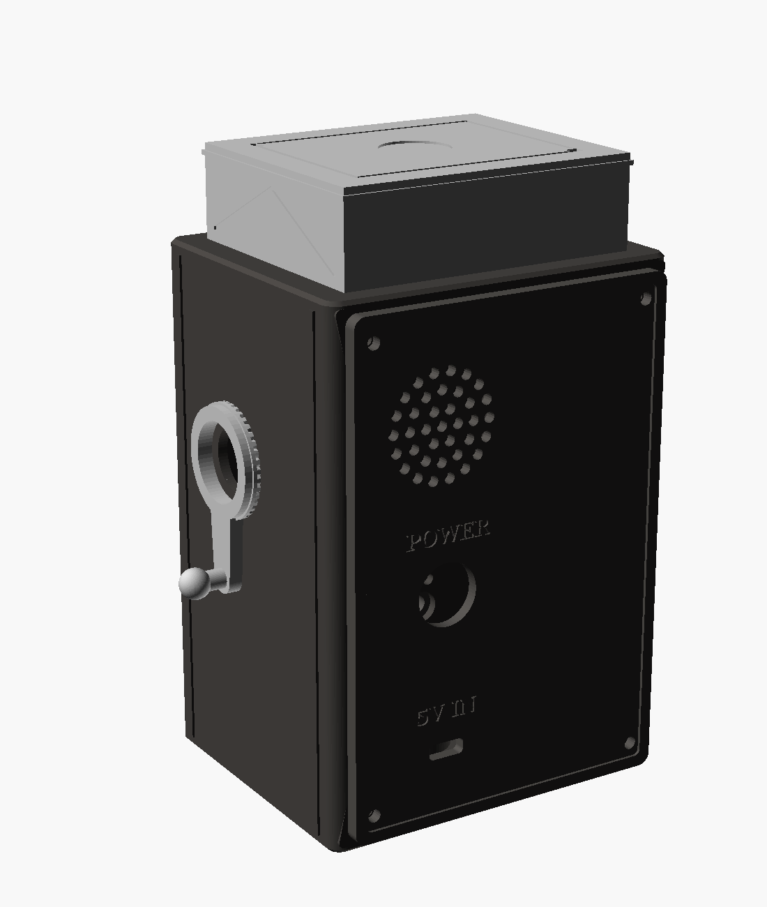

# Enclosure: twin-lens reflex

Body **96 × 80 × 136 mm** (W × D × H). The hood adds 24 mm on top and the
lenses add 23 mm in front. Every part fits a 180 × 180 mm bed.

## Layout

- **Lower "taking" lens:** the Camera Module 3 is screwed to the back of the
  lens board, looking out through a flared bore. The bore is sized to the
  camera's 75° view, so the barrel never shows up in the picture.
- **Upper "viewing" lens:** decorative. It has a pocket for an optional
  28 mm glass cabochon.
- **Lens board details:** the shutter ring is engraved with speeds, two
  knurled wheels sit between the lenses, and a SPEECHCAM nameplate is on top.
  The small "flash socket" bottom-left is the red REC light.
- **Hood:** the waist-level finder carries the green / yellow / red timing
  lights on its front, facing the speaker.
- **Controls:** the left focus knob rings the RECORD button and the right
  advance crank rings the MODE button.
- **Back door:** carries the Pi Zero W, the amp, the speaker grille, the
  POWER button and the 5 V USB-C inlet.

## Parts

| STL | Qty | Filament | Orientation / supports |
|---|---|---|---|
| `body.stl` | 1 | black PLA, **fuzzy skin** on (leatherette look) | as exported (front face down), no supports |
| `standard.stl` (lens board) | 1 | black PLA | back face down as exported, no supports |
| `door.stl` | 1 | black PLA, fuzzy skin | outside face down, no supports |
| `hood.stl` | 1 | silver PLA | lid down as exported, no supports |
| `knob.stl` | 1 | silver PLA | flat |
| `crank.stl` | 1 | silver PLA | flat |

Suggested settings: 0.2 mm layers, 3 walls, 15 % infill. Turn on fuzzy skin
(outer walls only, about 0.3 mm thickness) for the body and door. It looks a
lot like real camera leatherette. Paint the raised trim bands, lens rings and
nameplate letters with a chrome paint pen for the classic look.

## Before printing: check your camera board

The defaults match the Camera Module 3: 25 × 24 mm board, M2 holes 21 mm
apart, lens 9.5 mm below the top edge. If yours differs, edit the
`cam_*` values at the top of `enclosure/speechcam.scad` and re-export
(`openscad -D 'part="standard"' -o standard.stl speechcam.scad`).

## Hardware

- 8 × M3 × 10 self-tapping screws: 4 for the lens board (driven from inside the body), 4 for the back door
- 4 × M2 × 6 screws for the camera board
- 4 × M2.5 × 6 screws for the Pi Zero
- 1 × 1/4"-20 hex nut, glued into the floor boss (tripod thread)
- 3 × 16 mm panel-mount momentary push buttons
- CA glue or E6000

## Assembly order

1. **Tripod nut:** drop the 1/4"-20 nut into the hex pocket inside the floor
   and glue it.
2. **Camera:** screw the Camera Module 3 into the recess on the back of the
   lens board, with the lens in the square hole and the ribbon connector
   pointing down. Attach the Zero camera cable.
3. **Tally LED:** push the red LED into its hole from the back of the lens
   board.
4. **Lens board:** feed the ribbon and LED leads through the opening in the
   body front, then fix the board with 4 M3 screws from inside the body.
5. **Hood:** fit the green, yellow and red LEDs into its front and run the
   leads down through the hole in the body top. Glue the hood on.
6. **Buttons:** RECORD goes in the left side and MODE in the right. Glue the
   focus knob around the RECORD button bezel and the crank around the MODE
   button bezel.
7. **Back door:** screw the Pi Zero W onto the standoffs (USB ports facing
   the middle). Set the PAM8302 in its cradle and glue the speaker into the
   ring behind the grille. Mount the POWER button and the USB-C breakout
   behind the "5V IN" slot.
8. **Close up:** plug in the camera cable and the lav receiver, wire the
   GPIO, and screw the door on.
